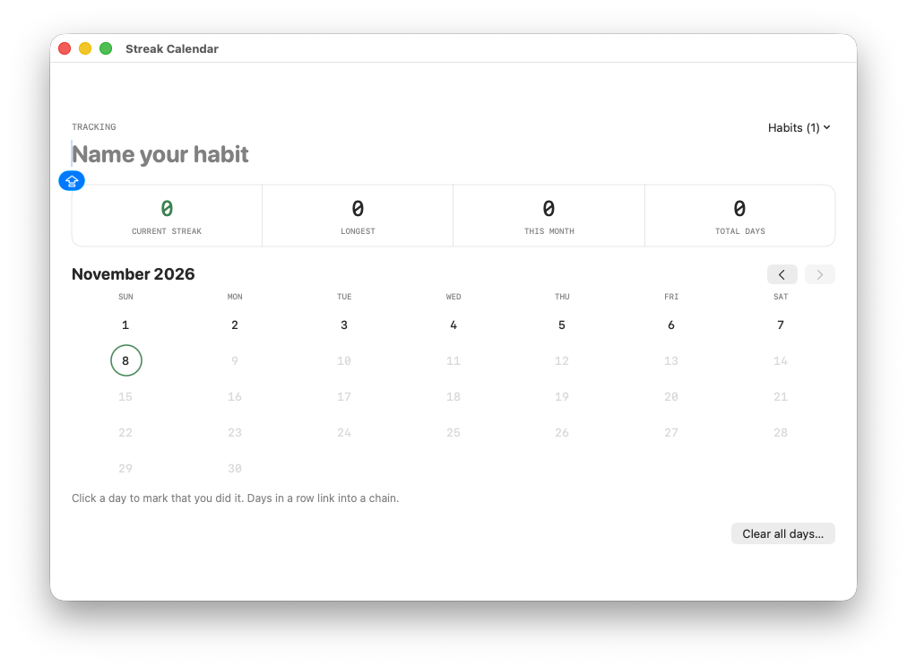
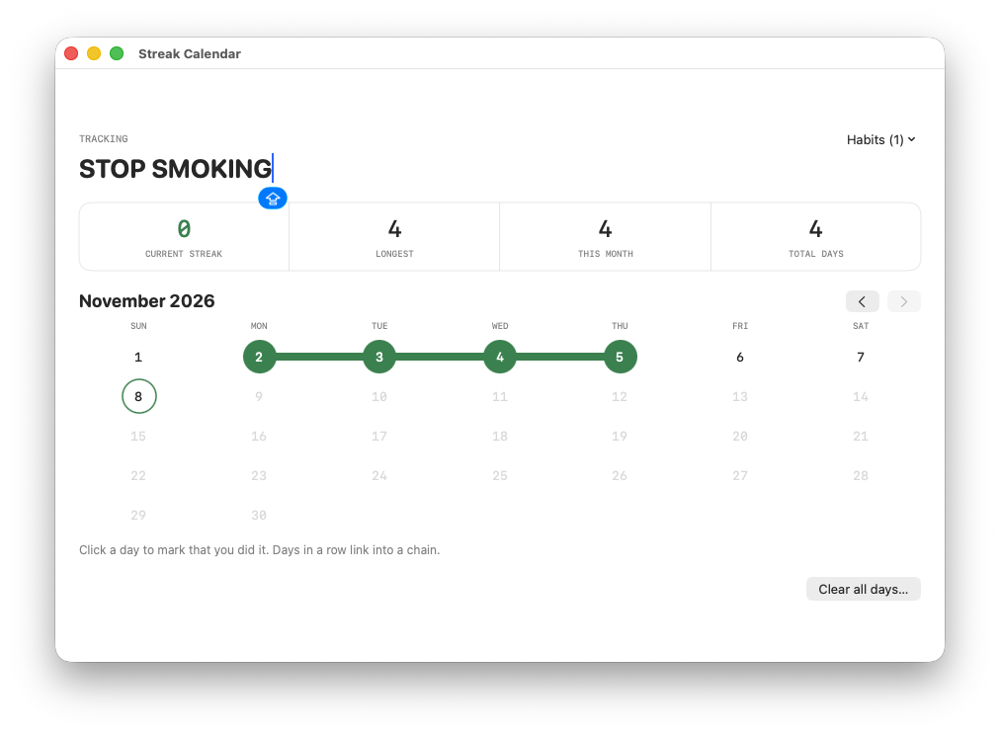
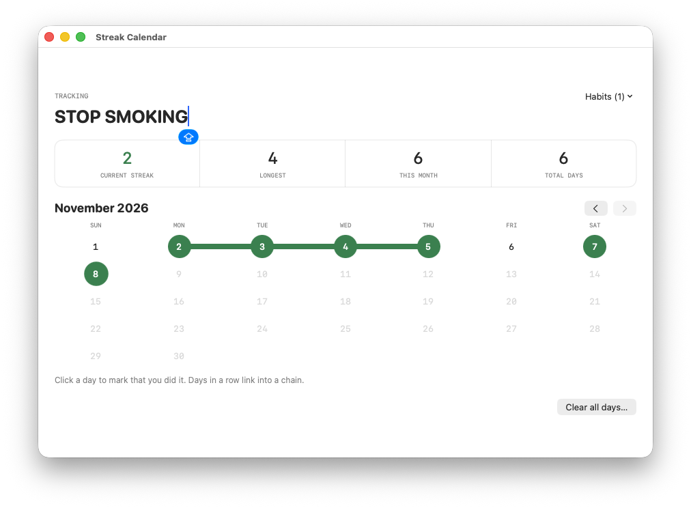

# 🔥 Streak Calendar

A native macOS habit tracker built with SwiftUI. Click the days you did a habit and watch consecutive days link into a streak chain.

| New habit | Building a streak | Chains & stats |
|:---:|:---:|:---:|
|  |  |  |

## Features
- Track multiple habits
- Click a day to mark it done; days in a row link into a chain
- Stats for each habit: current streak, longest streak, this month, total days
- Monthly view with a quick "Back to today" button

## Tech
Swift · SwiftUI · AppKit

## Requirements
- macOS 12 or later
- Apple Command Line Tools (the build script offers to install them)

## Build & run
```bash
chmod +x build.sh
./build.sh
```
The script compiles `Streak Calendar.app` and copies it to your Applications folder.
